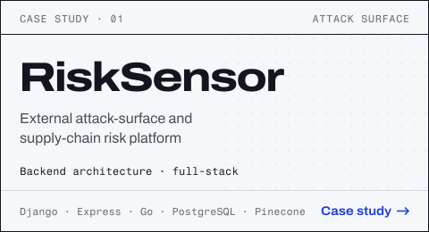
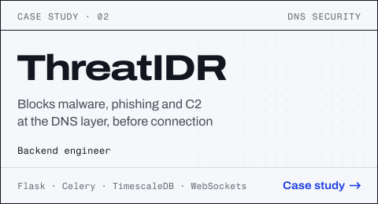

<picture>
  <source media="(prefers-color-scheme: dark)" srcset=".github/readme/banner-dark.svg" />
  
</picture>

  
  
  
  

I build the backend of security products and the interfaces on top of them. For 3.5+ years at [Pipeline Co., Ltd](https://www.ppln.co), a Japanese cyber-intelligence company, I have shipped API-first microservices, real-time threat-data pipelines and React dashboards for products like ThreatIDR and RiskSensor. I now lead an engineering team while staying hands-on on critical-path features.

## At a glance

| | |
|---|---|
| **Current role** | Team Lead, Software Engineering at Pipeline Co., Ltd |
| **Experience** | 3.5+ years in production, promoted twice in three years |
| **Strengths** | Microservices, event-driven systems, real-time data, security SaaS |
| **Looking for** | Full-stack, backend or team-lead roles in Europe (relocation or remote) |
| **Languages** | English, Bengali (native) |
| **Education** | BSc in Computer Science and Engineering (final year), Diploma in Computer Science Technology |

## Career

**[Pipeline Co., Ltd](https://www.ppln.co)** · Cybersecurity SaaS · Mar 2023 – present

- **Team Lead, Software Engineering** · Aug 2026 – present Lead and mentor an engineering team. Own sprint planning, code review standards and architecture decisions on API contracts, data models and service boundaries, and still ship critical-path features in Python, Django, React, Next.js and TypeScript.
- **Software Engineer** · Jul 2025 – Aug 2026 Designed API-first microservices in Node.js (Express) and Python (Django, Flask) with JWT authentication and role-based access control. Built real-time pipelines on Kafka and WebSockets and optimised schemas across PostgreSQL and MongoDB. Mentored junior developers and led code reviews.
- **Frontend Developer** · Mar 2023 – Jul 2025 Built React, Next.js and TypeScript applications from Figma designs, covered by Cypress end-to-end tests and deployed to AWS through GitHub Actions.

## Featured work

  <a href="https://imranhc0.vercel.app/projects/risk-sensor"><picture><source media="(prefers-color-scheme: dark)" srcset=".github/readme/card-risksensor-dark.svg" /></picture></a>
  <a href="https://imranhc0.vercel.app/projects/threatidr"><picture><source media="(prefers-color-scheme: dark)" srcset=".github/readme/card-threatidr-dark.svg" /></picture></a>

- **RiskSensor** · Architected the backend in Django, Express and Go, with data models on PostgreSQL, DynamoDB and Pinecone (vector search). [Product](https://www.ppln.co/risksensor) · [Case study](https://imranhc0.vercel.app/projects/risk-sensor)
- **ThreatIDR** · Backend in Flask and Celery, live threat monitoring over WebSockets, time-series storage in TimescaleDB. [Product](https://www.ppln.co/threatidr) · [Case study](https://imranhc0.vercel.app/projects/threatidr)
- **This portfolio** · Statically generated Next.js site with a markdown blog, Lighthouse 98–100 on mobile, no database, no tracking. [Live](https://imranhc0.vercel.app) · [Source](https://github.com/imranhc0/imranhc0)

## Tech stack

| Area | Tools |
|---|---|
| Languages | TypeScript, JavaScript, Python, Go |
| Backend | Node.js, Express, Django, Flask, Gin, REST APIs, microservices |
| Events and real-time | Kafka, WebSockets, Celery |
| Data | PostgreSQL, TimescaleDB, MongoDB, DynamoDB, Redis, Pinecone, Prisma |
| Frontend | React, Next.js, Redux, Zustand, Tailwind CSS, MUI |
| Security | JWT, RBAC, Zod validation, DNS security |
| Testing and delivery | Cypress, Docker, GitHub Actions, AWS |

## Writing

- [Designing API-First Security Products](https://imranhc0.vercel.app/blog/designing-api-first-security-products): structuring microservices and contracts for high-risk domains.
- [CI/CD Pipelines That Actually Reduce Risk](https://imranhc0.vercel.app/blog/ci-cd-pipelines-that-actually-reduce-risk): building rollback, validation and traceability into delivery.

 

<a href="mailto:imranhosein.cse@gmail.com"><picture>
  <source media="(prefers-color-scheme: dark)" srcset=".github/readme/contact-dark.svg" />
  
</picture></a>

Email <a href="mailto:imranhosein.cse@gmail.com">imranhosein.cse@gmail.com</a> · <a href="https://www.linkedin.com/in/imranhc0/">LinkedIn</a> · <a href="https://imranhc0.vercel.app">imranhc0.vercel.app</a>

